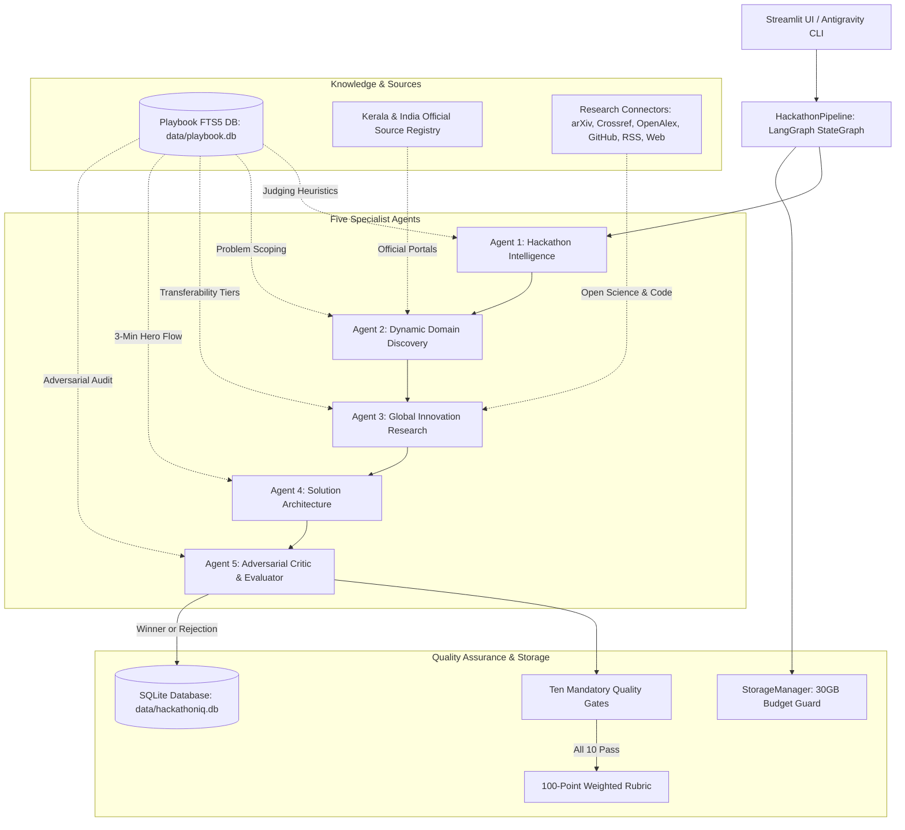

# HACKATHONIQ — SYSTEM ARCHITECTURE
## Autonomous Multi-Agent Intelligence, Competition Engineering, and Regional Localization

HackathonIQ is an autonomous, evidence-driven, local-first intelligence architecture designed to discover and recommend **ONE** exceptionally strong, differentiated, feasible, and hackathon-ready problem statement and solution.

---

## 1. High-Level System Architecture



---

## 2. Core Architectural Pillars

### 1. Evidence Before Generation (Strict Grounding)
- Every real-world problem claim must be corroborated by at least **two independent, credible sources** (credibility $\ge 0.60$).
- Synthetic data, manufactured competitor names, and hallucinated URLs are strictly filtered by deterministic validators (`SSRFGuard`, `allowed_urls`, `sanitize_model_urls`).

### 2. Deterministic Quality Gates over LLM Optimism
- A candidate must satisfy **Ten Mandatory Quality Gates** computed deterministically before any 100-point rubric score applies.
- An LLM may veto a gate or propose score adjustments, but deterministic checks enforce hard vetoes for missing evidence, unavailable dependencies, or deadline breaches.

### 3. Geographical Strategy: Kerala First, India Scale, Global Benchmarking
- **Kerala First**: Grounded in all 14 districts and 5 agro-ecological zones (Wayanad landslides, Palakkad drought, Kuttanad flooding, coastal salinity), smallholder homestead farm sizes (<0.5 ha), monsoon cloud-cover dynamics, and vernacular Malayalam accessibility.
- **India Scale**: Scalable to national initiatives and ministries via `data.gov.in`, ICAR, IMD, ISRO, and NITI Aayog.
- **Global Innovation**: Evaluated via a **5-tier transferability taxonomy (Tiers A through E)** to avoid the "thin API wrapper" trap and ensure genuine technological adaptation.

### 4. Zero Paid Cloud AI & Strict 30 GB Storage Budget
- **Hardware Target**: AMD Ryzen 5 8645HS with Radeon 760M Graphics + NVIDIA GeForce RTX 3050 Laptop GPU (6 GB VRAM) on Windows.
- **Local AI**: 100% powered by local Ollama serving `qwen2.5:3b` with full GPU offloading (2.5 GB dedicated VRAM). Zero paid cloud API subscriptions.
- **Storage Budget**: Strict 30 GB application storage budget enforced by `StorageManager` download guards, automatic cache pruning, and disk monitoring.

### 5. Memory Footprint Optimization (79.4% RAM Reduction)
- **Garbage Collection**: Explicit `gc.collect()` at pipeline stage boundaries.
- **HTML DOM Cleanup**: `BeautifulSoup.decompose()` after text extraction in `src/research/http_client.py`.
- **Connection Stewardship**: Explicit connection closing in `SearchRegistry` and context-managed SQLite connections.

---

## 3. The Multi-Agent Pipeline Workflow

```
[Start Session]
      │
      ▼
1. Prepare Node: Ingest continuous intelligence context & verify storage budget
      │
      ▼
2. Agent 1 (Hackathon Intelligence):
   - Deconstruct theme & judging criteria using Playbook heuristics
   - Detect General Theme Mode (unbiased) vs Event Mode
   - Classify constraint provenance (USER_PROVIDED, OFFICIAL, HYPOTHESIS)
      │
      ▼
3. Agent 2 (Domain & Problem Discovery):
   - Discover domains dynamically without arbitrary limits (budget-bounded)
   - Consult Kerala & India Official Source Registry (DES ODR, KAU, KSDMA)
   - Attach independent empirical evidence to each problem candidate
      │
      ▼
4. Agent 3 (Global Innovation Research):
   - Search global repositories (GitHub, arXiv, OpenAlex, Crossref)
   - Identify existing solutions and classify innovation gap
   - Tag 5-tier transferability taxonomy (Tier A through E)
      │
      ▼
5. Agent 4 (Solution Architecture):
   - Architect concrete implementation (FastAPI, SQLite, open weights)
   - Scope hours to fit deadline (<= 1.15 * hours, demo-ready in <=36h)
   - Detail Kerala adaptation, zero-paid-API economics, and 3-minute hero flow
      │
      ▼
6. Agent 5 (Adversarial Critic & Independent Evaluator):
   - Execute bounded multi-round adversarial debate
   - Enforce Ten Mandatory Quality Gates
   - Apply 100-Point Rubric (normalizing 90-pt raw in General Theme Mode)
   - Crown ONE definitive winner OR honestly reject all candidates
      │
      ▼
7. Report Generation Node:
   - Produce 24-section comprehensive markdown report
   - Persist session, agent outputs, debate logs, and final evaluation
      │
      ▼
[Finalize & Return Result]
```

---

## 4. Subsystem Deep-Dives

### 1. Hackathon Playbook Knowledge Base (`src/knowledge/hackathon_playbook/`)
- Permanent SQLite database (`data/playbook.db`) with `playbook_fts` (FTS5 full-text index).
- 28 seed lessons across theme deconstruction, problem selection, technical architecture, 3-minute demo pitches, sensor scale audits, and winner patterns.
- Dedicated retrieval API for each of the 5 agents.

### 2. Kerala & India Official Source Registry (`src/research/sources/kerala_india_registry.py`)
- Master catalog of 14 official government repositories, research institutes, and satellite portals.
- Domain-to-authority recommendation engine and targeted search query generator.

### 3. Evaluation Service (`src/evaluation/rubric.py`)
- Enforces the **Ten Mandatory Quality Gates**:
  1. Theme and Judging Alignment
  2. Real-World Problem Validation (>= 2 independent sources, cred >= 0.60)
  3. Kerala and India Relevance
  4. Existing-Solution Investigation
  5. Genuine Innovation and Differentiation (diff >= 30 chars)
  6. Global-to-Local Adaptability (5-tier taxonomy)
  7. Technical Feasibility and Data Availability (zero unavailable deps)
  8. Economic and Practical Viability (zero paid SaaS APIs)
  9. Hackathon Buildability and Demonstration (hours <= 1.15 * deadline, demo plan)
  10. Risk, Ethics and Sustainability (>= 2 risks, >= 1 disadvantage, >= 1 mitigation)
- **100-Point Scoring Rubric**: In General Theme Mode, Organizer Alignment (10 pts) is unassessable; raw score is calculated out of 90 and normalized to 100.

---

## 5. Multi-Track Architecture & Cross-Track Comparison

HackathonIQ natively supports competitions with an arbitrary number of tracks (e.g. 1, 2, 6, 8+ tracks) via `HackathonPipeline.run_multi_track()` and `CrossTrackComparisonEngine`.

### 1. Two-Tier Execution Model
- **Shared Organizer Research (Agent 1)**: Executed once per multi-track run. Analyzes organizer background, rules, and overarching criteria to establish a shared intelligence context (`shared_intelligence`).
- **Sequential Track Pipeline (Agents 2–5)**: Runs independently per track in strict sequential order. Each track discovers specialized domains, conducts gap analysis, drafts buildable architectures, undergoes adversarial debate, and generates an individual track report (`R-<session_id>-track-<track_id>.md`).

### 2. Cross-Track Comparison Engine (`src/evaluation/cross_track_comparison.py`)
- **Mode A (Best Overall Track)**: Cross-compares all qualifying candidates across all tracks under uniform standards to crown the single most defensible overall winner, with explicit comparative explanations for runner-ups.
- **Mode B (Best Idea Per Track)**: Crowns the top qualifying idea independently for each track. For tracks failing any of the 10 gates, it outputs: `"No qualifying problem statement found for this track."`
- **Duplicate & Overlap Detection**: Uses token Jaccard similarity (threshold 0.58) to detect candidates submitted across tracks, allocating them to their best-fit track based on track descriptions and preventing cross-track cannibalization.

### 3. Resource & Laptop GPU Safeguards
- Runs on local Ryzen 5 + RTX 3050 Laptop GPU (6 GB VRAM) with zero concurrency spikes.
- Enforces explicit `gc.collect()` after each track execution.
- Employs intermediate SQLite state persistence and fault-tolerant error boundaries per track.
- Generates master cross-track intelligence reports (`R-<session_id>-multitrack.md`).

