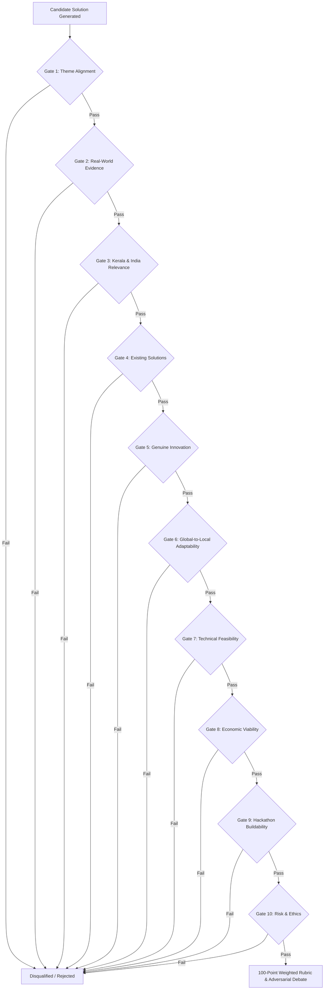

# HACKATHONIQ — EVALUATION FRAMEWORK & QUALITY ASSURANCE
## Ten Mandatory Quality Gates, 100-Point Weighted Rubric, and Adversarial Debate

HackathonIQ enforces an uncompromising, multi-tier evaluation system. High rubric scores can **never** bypass a failed mandatory quality gate.

---

## 1. Ten Mandatory Problem-Statement Evaluation Gates

Before any 100-point rubric scoring can qualify a candidate, it must satisfy all **Ten Mandatory Quality Gates**. If even a single gate fails, the candidate is disqualified (`is_qualified = False`).

### Detailed Gate Specifications:

1. **Gate 1: Hackathon Theme and Official Judging Alignment**:
   - *Requirement*: The candidate must directly address the central hackathon theme and conform to supplied constraints.
   - *Mode Detection*: In General Theme Mode (no organizer specified), verifies theme goals without fabricating organizer rules.
2. **Gate 2: Real-World Problem Validation**:
   - *Requirement*: At least **two independent, credible sources** (academic papers, government bulletins, or official datasets) with credibility >= 0.60 must corroborate the problem's existence and urgency. Single-source claims fail automatically.
3. **Gate 3: Kerala and India Relevance**:
   - *Requirement*: The problem must have documented, verified relevance to Kerala (at least one district, ecological zone, or demographic group) and clear scalability across Indian national contexts.
4. **Gate 4: Existing-Solution Investigation**:
   - *Requirement*: Real existing solutions or GitHub repositories must be investigated and documented. A blank summary or failure to inspect competitors causes automatic rejection.
5. **Gate 5: Genuine Innovation and Differentiation**:
   - *Requirement*: Honest opportunity classification (`differentiated`, `underserved`, or `existing_solution_with_important_limitations`) accompanied by a concrete differentiation claim of **>= 30 characters** explaining why this is not merely a clone.
6. **Gate 6: Global-to-Local Adaptability**:
   - *Requirement*: Concrete adaptation analysis applying the **5-Tier Transferability Taxonomy (A–E)**, specifying required local modifications (e.g. Malayalam support, offline sync) and local constraints respected.
7. **Gate 7: Technical Feasibility and Data Availability**:
   - *Requirement*: Concrete technical architecture specified, estimated hours > 0, and zero critical data or API dependencies marked as "unavailable".
8. **Gate 8: Economic and Practical Viability**:
   - *Requirement*: Estimated deployment cost cannot be "prohibitive" or "expensive". Mandatory paid cloud API subscriptions are prohibited; open-source and free government APIs must be utilized.
9. **Gate 9: Hackathon Buildability and Demonstration**:
   - *Requirement*: Estimated engineering hours must fit the hackathon timeline: $\text{hours} \le 1.15 \times \text{available hours}$ (default $\le 36\text{h}$). Must include a concrete, demonstrable 3-minute hero user flow.
10. **Gate 10: Risk, Ethics and Sustainability**:
    - *Requirement*: At least **2 real risks**, at least **1 disadvantage**, and at least **1 concrete mitigation strategy** must be documented, alongside ethical data privacy considerations.

---

## 2. 100-Point Weighted Scoring Rubric

Once all 10 gates pass, the candidate is scored across the eight agreed criteria:

| Criterion | Weight | Assessment Focus |
| :--- | :---: | :--- |
| **Real-world problem significance** | 15 | Livelihood stakes, affected population size, severity of consequences if unsolved |
| **Originality and differentiation** | 15 | Uniqueness relative to existing open-source and commercial solutions |
| **Technical feasibility** | 15 | Soundness of architecture, availability of training data/APIs, realistic complexity |
| **Hackathon theme relevance** | 15 | Directness of alignment with the hackathon theme |
| **Organizer and sponsor alignment** | 10 | Fit with organizer goals, sponsor APIs, and prize tracks *(See General Theme Mode below)* |
| **Innovation and future potential** | 10 | Long-term roadmap, scientific credibility, scalability beyond the hackathon |
| **Implementation within deadline** | 10 | Scope appropriateness, buildability in 24-36 hours, dependency simplicity |
| **Demonstration and judging appeal** | 10 | 3-minute hero flow, visual appeal, interactive live demonstration potential |
| **Total Weight** | **100** | |

### General Theme Mode (Unbiased Theme Research)
When HackathonIQ is run on a general theme without a specified hackathon organizer or sponsor:
- **Organizer and Sponsor Alignment (10 pts)** is explicitly marked **NOT ASSESSABLE** and assigned 0.0 points.
- The candidate is scored across the remaining 7 assessable criteria, yielding a **Raw Score out of 90 points**.
- The score is then normalized to the standard 100-point scale:
  $$\text{Normalized Score} = \left(\frac{\text{Raw Score}}{90}\right) \times 100$$
- This ensures candidates evaluated without organizer briefs are not penalized, while preventing agents from fabricating fictional organizer goals.

---

## 3. Adversarial Debate Mechanics

Agent 5 acts as an independent, adversarial judge:
1. **Hostile Examination**: Identifies up to 5 critical vulnerabilities across sensor scale, ground-truth availability, digital literacy barriers, and competitor overlap.
2. **Evidence-Backed Rebuttal**: The architect is challenged to defend the solution using cited evidence.
3. **Score Adjustment**: Unresolved critical flaws trigger justified score downgrades (up to -20 points). Exceptionally defended rebuttals may earn minor adjustments (up to +5 points).
4. **Disqualification on Rejection**: If the adversarial critic issues an unresolved "reject" verdict during debate, `is_qualified` is set to `False`.

---

## 4. Final Winner Selection vs Honest Rejection

The system applies strict decision rules for final winner selection:
- **Qualification Threshold**: A candidate must pass all 10 gates, maintain `is_qualified = True`, and achieve a post-debate score of **>= 60.0/100**.
- **Exactly ONE Winner**: The highest-scoring qualified candidate is selected as the winning recommendation.
- **Honest Rejection**: If zero candidates satisfy all gates and achieve >= 60.0/100, HackathonIQ reports an honest rejection:
  - Explains the exact root causes of rejection (e.g. `RESEARCH_INSUFFICIENT`, `DEADLINE_EXCEEDED`, `LOCALIZATION_MISSING`).
  - Outlines concrete, actionable remediation steps for the next research iteration.
