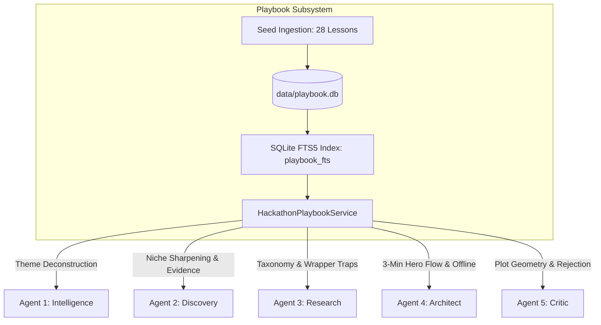

# HACKATHONIQ — HACKATHON PLAYBOOK KNOWLEDGE BASE
## Empirical Heuristics, Winner Patterns, and Judging Intelligence

The **Hackathon Playbook Knowledge Base** is a permanent, embedded subsystem in HackathonIQ (`src/knowledge/hackathon_playbook/`) providing distilled insights from real hackathon competitions, Devpost judging guidelines, MLH rules, YouTube judge/winner retrospectives, Bread04's hackathon guide, and Microsoft Agent Academy.

---

## 1. Subsystem Architecture

The playbook is powered by a high-performance SQLite database with an integrated **FTS5 Full-Text Search Index** (`playbook_fts`), enabling sub-millisecond retrieval of relevant competition tactics for each logical agent.



---

## 2. Playbook Categories & Taxonomic Framework

The playbook organizes lessons into eight core categories:

1. **`theme_deconstruction`**: Dissecting broad marketing themes (e.g. 'AI for Good') into concrete biophysical, economic, or logistical workflows.
2. **`problem_selection`**: Selecting high-stakes, specific pain points with measurable livelihood or economic damage metrics.
3. **`technical_architecture`**: Designing realistic architectures for 24-36 hour hackathon builds, zero paid cloud API dependencies, and offline-first data synchronization.
4. **`demo_engineering`**: The **3-minute Hero User Flow rule**, pre-computed fallback scenarios, and presentation storytelling.
5. **`adversarial_defense`**: Defending against technical cross-examination, spatial scale mismatches, and ground-truth validation.
6. **`winner_patterns`**: The four pillars of hackathon judging (Significance, Originality, Technical Execution, Presentation Appeal).
7. **`failure_modes`**: Common failure traps: the "thin API wrapper", the "over-engineered IoT hardware" pitfall, and toy demos.
8. **`localization_strategy`**: Grounding technology in regional contexts (Kerala's 5 agro-ecological zones, smallholder homestead plots, Malayalam vernacular access).

---

## 3. Curated Seed Lessons Ingested

| ID | Category | Title | Target Agent | Primary Origin | Core Heuristic Summary |
| :--- | :--- | :--- | :--- | :--- | :--- |
| **HP-001** | `theme_deconstruction` | Distinguish Stated Theme from Intent | `agent_1_intelligence` | Devpost Judging Guide | Judges grade on tangible workflows, not marketing slogans. Deconstruct into concrete metrics. |
| **HP-002** | `theme_deconstruction` | Honest Handling of General Theme Mode | `agent_1_intelligence` | MLH Playbook | In the absence of an organizer, never invent fictional sponsors; mark organizer alignment unassessable. |
| **HP-004** | `problem_selection` | Concrete Niche Trumps Generic Aggregator | `agent_2_domain` | YouTube Retrospective | Narrow, high-stakes pain points defeat vague "all-in-one" platforms every time. |
| **HP-005** | `problem_selection` | Require Two Independent Sources | `agent_2_domain` | Microsoft Agent Academy | Mandatory corroboration by >= 2 independent authorities to prevent single-source hallucination. |
| **HP-006** | `localization_strategy` | Kerala Agro-Ecological Diversity | `agent_2_domain` | YouTube Retrospective | Recognize Kerala's 5 distinct zones (High Ranges, Central Plains, Coastal, Kuttanad below-sea-level). |
| **HP-008** | `winner_patterns` | Global Innovation with Local Grounding | `agent_3_research` | YouTube Retrospective | Benchmark international state-of-the-art research (CGIAR, FAO) and adapt algorithms to local realities. |
| **HP-009** | `failure_modes` | Avoid the "Thin API Wrapper" Trap | `agent_3_research` | Devpost Judging Guide | Ruthlessly penalize prompt wrappers around commercial LLMs; demand multi-stage domain engines. |
| **HP-011** | `localization_strategy` | The 5-Tier Adaptation Taxonomy (A–E) | `agent_3_research` | Microsoft Agent Academy | Classify global research transferability: Tier A (Direct) to Tier E (Locally originated native). |
| **HP-012** | `technical_architecture` | Scope to 24-36 Hour Buildability | `agent_4_solution` | Bread04 Hackathon Guide | Never attempt training large models from scratch; combine pre-trained open weights with domain heuristics. |
| **HP-013** | `technical_architecture` | Offline-First Rural Deployability | `agent_4_solution` | YouTube Retrospective | Systems assuming continuous 5G collapse in rural field conditions; build SQLite/IndexedDB caching. |
| **HP-014** | `demo_engineering` | The 3-Minute Hero User Flow Rule | `agent_4_solution` | Devpost Judging Guide | Demo must execute end-to-end in <= 3 minutes: input sample -> instant computation -> actionable visual result. |
| **HP-015** | `technical_architecture` | Zero Paid Cloud API Mandate | `agent_4_solution` | Microsoft Agent Academy | Rely entirely on open weights (Ollama/Qwen) and free open government data; zero recurring API costs. |
| **HP-016** | `technical_architecture` | Scientific Hybrid: MCDA + Ecological ML | `agent_4_solution` | YouTube Retrospective | Pair deterministic biophysical envelope filtering (ICRAF) with statistical presence models (MaxEnt). |
| **HP-017** | `adversarial_defense` | Sensor Resolution vs Farm Plot Scale | `agent_5_critic` | YouTube Retrospective | Audit satellite pixel size against plot size (10m Sentinel-2 vs 0.2 ha smallholder plot in Kerala). |
| **HP-018** | `adversarial_defense` | Audit Synthetic Data vs Ground Truth | `agent_5_critic` | Microsoft Agent Academy | Demand verified public data (Copernicus, IMD, GBIF); bound claims if synthetic data is used for testing. |
| **HP-020** | `winner_patterns` | Willingness to Reject All Honestly | `agent_5_critic` | Devpost Judging Guide | If all candidates fail technical or ethical gates, honest rejection is superior to crowning a flawed project. |
| **HP-021** | `adversarial_defense` | Language and Digital Literacy Barrier | `agent_5_critic` | YouTube Retrospective | Audit accessibility for non-English speakers (Malayalam audio/voice prompt options). |

---

## 4. Agent Retrieval Service API

The `HackathonPlaybookService` provides dedicated retrieval methods for each logical agent:

```python
from src.knowledge.hackathon_playbook import HackathonPlaybookService

service = HackathonPlaybookService()

# Agent 1: Theme & judging intent
a1_lessons = service.retrieve_for_intelligence("Agriculture and Climate")

# Agent 2: Problem selection and Kerala localization
a2_lessons = service.retrieve_for_domain_discovery("Climate-Resilient Agriculture")

# Agent 3: Innovation benchmarking and transferability
a3_lessons = service.retrieve_for_innovation_research("Agroforestry")

# Agent 4: Buildability scoping and 3-minute demo pitch
a4_lessons = service.retrieve_for_solution_architect("Agroforestry", hours=36.0)

# Agent 5: Sensor scale audit and honest rejection standards
a5_lessons = service.retrieve_for_adversarial_critic("AI Agroforestry System")

# Format into injectable LLM prompt context
prompt_context = service.format_guidance_for_prompt(a1_lessons)
```
