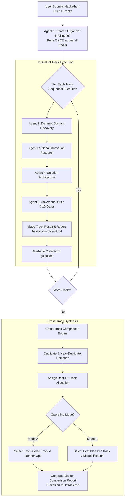

# Multi-Track Hackathon Intelligence: Architectural Specification & Guide

## 1. Executive Overview

Real-world hackathons frequently partition competition themes into specialized tracks (e.g., *Agriculture & Food Security*, *Healthcare*, *FinTech*, *Climate & Sustainability*, *Education*, *Smart Cities*). HackathonIQ extends its autonomous five-agent research engine to natively support multi-track hackathons of **arbitrary track count** without artificial limits.

HackathonIQ offers two distinct user-selectable operating modes:
- **Mode A — Best Overall Track**: Identifies the single strongest, most defensible project opportunity across all supplied tracks, ranking qualifying candidates on uniform criteria and providing clear, evidence-based runner-up explanations.
- **Mode B — Best Idea Per Track**: Identifies the strongest qualifying idea independently for every supplied track. If no candidate in a given track satisfies every mandatory qualification gate, the system honestly reports:
  > *"No qualifying problem statement found for this track."*

---

## 2. Architecture & Execution Workflow

### 2.1 Shared vs. Track-Specific Execution

To optimize compute efficiency while ensuring uncompromised domain specialization, HackathonIQ separates research into two phases:

1. **Phase 1: Shared Organizer Research (Agent 1 — Executed Once)**:
   - Analyzes the organizer's background, judging criteria, technical restrictions, sponsors, and ideology.
   - Establishes a shared hackathon intelligence baseline persisted under `shared_intelligence`.
   - Reused across all tracks, saving LLM inference time and avoiding redundant queries.

2. **Phase 2: Independent Sequential Track Research (Agents 2–5 per Track)**:
   - **Agent 2 (Domain Discovery)**: Dynamically discovers problem domains tailored to the specific track theme and track-specific rules.
   - **Agent 3 (Global Innovation Research)**: Scouts existing GitHub repositories, arXiv papers, and existing products for that track.
   - **Agent 4 (Solution Architect)**: Formulates buildable, differentiated solutions and global-to-local adaptations (Kerala & India localization).
   - **Agent 5 (Adversarial Critic)**: Submits candidates to adversarial debate, applies the 100-point rubric, and enforces the 10 mandatory qualification gates.
   - Generates an individual track report (`R-<session_id>-track-<track_id>.md`).

---

## 3. Resource Safety & Sequential Execution

HackathonIQ is engineered to run locally on developer workstations (e.g., AMD Ryzen 5, NVIDIA RTX 3050 Laptop GPU with 6 GB VRAM, 16 GB System RAM).

Key safeguards implemented in the multi-track pipeline:
- **Strict Sequential Execution**: Tracks are processed strictly one at a time. Multiple LLM inference workflows are never invoked concurrently, preventing CUDA out-of-memory crashes.
- **Explicit Garbage Collection**: `gc.collect()` is invoked between pipeline stages and immediately after each track completes, reclaiming intermediate tensors and Python heap allocations.
- **Intermediate Persistence**: Each completed track immediately saves its structured findings to SQLite and writes its report to disk (`data/reports/`).
- **Fault-Tolerant Recovery**: If an individual track fails (e.g., due to an invalid track URL or unexpected model failure), the pipeline logs the failure, records `status="failed"`, and proceeds to evaluate the remaining tracks. The master report reflects the failure without aborting the research run.

---

## 4. Cross-Track Comparison Engine (`CrossTrackComparisonEngine`)

The `CrossTrackComparisonEngine` provides unified, transparent cross-track evaluation.

### 4.1 Token-Based Jaccard Duplicate Detection
When multi-track inputs are researched, candidates in different tracks might propose overlapping or near-identical solutions.
- The engine computes token-level Jaccard similarity across candidate problem statements, solutions, and unique differentiators (threshold = 0.58).
- When a duplicate or near-duplicate is detected:
  - The candidate is assigned to its **best-fit track** based on lexical and domain overlap with track descriptions.
  - The duplicate in the non-fitting track is deduplicated from overall winner contention, ensuring a team cannot win a track with a misplaced idea.

### 4.2 Mode A vs. Mode B Winner Selection
- **Mode A (Best Overall Track)**:
  - Evaluates all qualifying candidates across all tracks under uniform 100-point rubric standards.
  - Selects the single highest scoring candidate whose project passed all 10 mandatory quality gates.
  - Synthesizes clear runner-up explanations contrasting the winner with contenders from other tracks.
- **Mode B (Best Idea Per Track)**:
  - Independently checks each track for qualifying candidates.
  - If a track contains a qualifying winner, that winner is crowned.
  - If no candidate in a track passed all 10 gates, the system outputs the exact required product statement:
    > *"No qualifying problem statement found for this track."*
- **Honest Rejection**: If no candidate across any track satisfies all 10 gates, HackathonIQ refuses to invent a winner, upholding absolute scientific integrity.

---

## 5. Data Model & Database Schema

### 5.1 SQLite Migrations (Migration 003)
The database was updated via Migration 003:
- **`sessions` Table Alteration**: Added `is_multi_track INTEGER DEFAULT 0` and `multi_track_mode TEXT DEFAULT 'best_overall'`.
- **`hackathon_tracks` Table**:
  - `id` (TEXT PRIMARY KEY)
  - `session_id` (TEXT REFERENCES sessions(id))
  - `track_name` (TEXT)
  - `description` (TEXT)
  - `track_rules` (TEXT)
  - `official_url` (TEXT)
  - `created_at` (DATETIME)
- **`multi_track_comparisons` Table**:
  - `session_id` (TEXT PRIMARY KEY)
  - `mode` (TEXT)
  - `comparison_json` (TEXT)
  - `created_at` (DATETIME)

### 5.2 Pydantic Models (`src/models/multitrack.py`)
- `HackathonTrack`: Track configuration (ID, name, description, track rules, URL).
- `TrackResult`: Full execution result for a single track.
- `CrossTrackComparisonItem`: Standardized 0-10 metric comparison candidate.
- `CrossTrackComparisonResult`: Complete comparison result with rankings, duplicate resolutions, and rationale.
- `MultiTrackPipelineResult`: Master container holding shared intelligence, all track results, cross-track comparison, and master report.

---

## 6. Streamlit User Interface Integration

1. **`ui/pages/new_research.py`**:
   - Checkbox: *"Enable Multi-Track Hackathon Research"*.
   - Mode Selector: Radio buttons for *Mode A (Best Overall Track)* vs. *Mode B (Best Idea Per Track)*.
   - Dynamic Track Input: Supports 1 to 30+ tracks. Users can input Track Name, Description, Specific Rules/Constraints, and Official Track URL.
   - Live activity log streams track-by-track execution progress.

2. **`ui/pages/results.py`**:
   - Automatically detects multi-track sessions.
   - **Mode A View**: Overall Winning Track banner, Candidate Score, Gate Status, Cross-Track Comparison Table, Runner-Up Explanations, Duplicate Analysis, and Track-by-Track drilldown tabs.
   - **Mode B View**: Grid of per-track winners or explicit *"No qualifying problem statement found for this track."* warnings with gate failure details.
   - Download buttons for both track-specific reports and Master Multi-Track Comparison Report (`hackathoniq_<id>_multitrack.md`).

3. **`ui/pages/history.py`**:
   - Shows a `[MULTI-TRACK]` badge and track count in session history.
   - Reconstructs full multi-track results seamlessly upon loading.

---

## 7. Automated Test Suite (17 Scenarios Verified)

The comprehensive test suite in `tests/unit/test_multitrack.py` verifies all 17 required scenarios:
1. `test_scenario_01_single_track_execution`: Multi-track pipeline handles single track seamlessly.
2. `test_scenario_02_two_track_execution`: Sequential evaluation of two tracks and comparison generation.
3. `test_scenario_03_six_track_execution`: Classic 6-track hackathon execution without memory issues.
4. `test_scenario_04_more_than_six_tracks_execution`: 8 tracks verified to confirm no hardcoded track limit.
5. `test_scenario_05_different_domain_discoveries_across_tracks`: Tracks explore distinct domains (Healthcare vs. Agriculture).
6. `test_scenario_06_shared_organizer_research_executed_once`: Agent 1 is executed exactly once across all tracks.
7. `test_scenario_07_independent_track_research`: Independent domain maps, innovation gaps, and candidates per track.
8. `test_scenario_08_track_specific_evidence_no_leakage`: Unique track report IDs and independent evidence tracking.
9. `test_scenario_09_duplicate_candidate_detection_and_best_fit_resolution`: Jaccard similarity detection and best-fit track allocation.
10. `test_scenario_10_best_overall_track_selection_mode_a`: Selection of single highest scoring qualifying candidate and runner-up explanations.
11. `test_scenario_11_best_idea_per_track_selection_mode_b`: Independent qualifying winners per track.
12. `test_scenario_12_track_where_no_candidate_passes`: Exact *"No qualifying problem statement found for this track."* output for disqualified tracks.
13. `test_scenario_13_all_tracks_failing_qualification_honest_rejection`: Honest rejection when all tracks fail gates.
14. `test_scenario_14_track_specific_official_judging_criteria_mapping`: Track rules and URLs passed to track agents.
15. `test_scenario_15_resource_safe_sequential_execution_and_gc`: Verification of sequential execution and `gc.collect()`.
16. `test_scenario_16_fault_tolerant_recovery_when_track_fails`: Unaffected tracks continue if one track fails.
17. `test_scenario_17_historical_single_track_backward_compatibility`: Historical single-track runs remain 100% backward-compatible.
